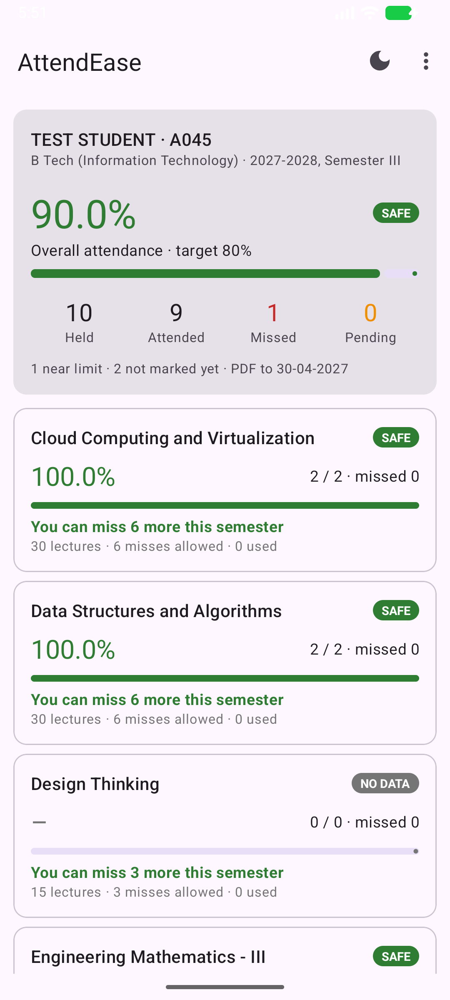
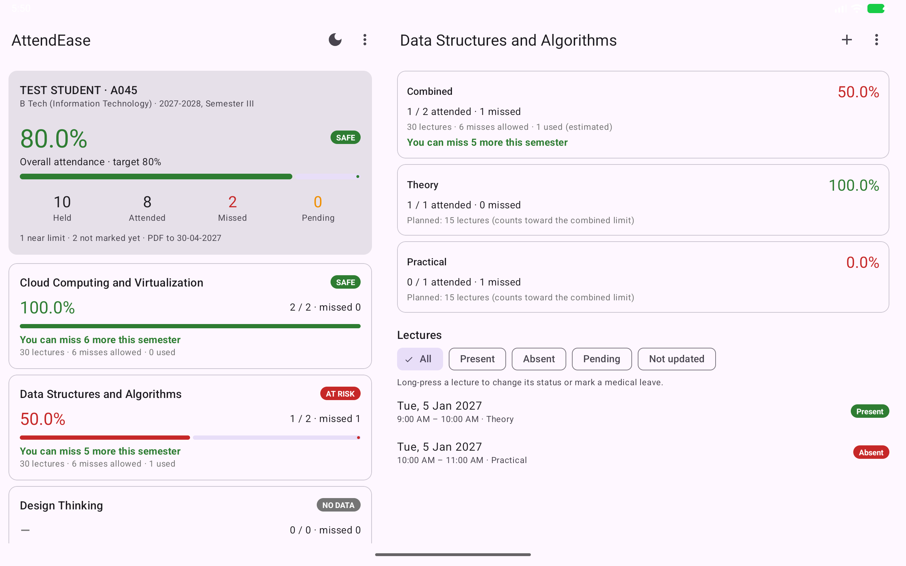

# AttendEase

An offline Android app for college students. It reads the attendance report PDF from the
SAP student portal and works out, subject by subject, where you stand against your college's
attendance rule and how many lectures you can still miss this semester. It also tracks
medical-leave requests the college hasn't decided yet.

> **Unofficial.** AttendEase is an independent student project. It is not made, endorsed or
> supported by SVKM's NMIMS, by SAP, or by any college. Its figures are estimates from the
> PDF you upload; your college's records and rules always decide.

<p>
  
  
</p>

Screenshots use placeholder data. More are in [`docs/devices`](docs/devices).

---

## Download

Get the latest `AttendEase-v<version>.apk` from the
[Releases page](https://github.com/fortunatechick/AttendEase/releases/latest).

- **Works on:** Android 5.0 or newer, phones, tablets, foldables and Chromebooks. The single APK fits every device.
- **Install:** open the APK on the phone. If Android asks, allow your browser or Files app to *install unknown apps*.
- **Update:** install the newer APK over the old one. Your data is kept. The app can't check for updates itself (it has no internet access); *Settings → Check for updates* opens the Releases page.

### Verify the APK

Every release is signed with the same key. Before installing, you can check the signing
certificate with `apksigner` from the Android SDK build-tools:

```bash
apksigner verify --print-certs AttendEase-v1.0.0.apk
```

The `SHA-256 digest` it prints must be:

```
(published here with the first signed release)
```

Each release also lists the APK's own SHA-256 checksum.

### Coming from an earlier test build

Builds before 1.0.0 used a temporary package name, so Android treats 1.0.0 as a **different
app**. It installs alongside the old one and the old data doesn't carry over. Export a CSV
from the old app if you want a copy, uninstall it, then install 1.0.0 and upload your PDF again.

---

## What it does

- **Reads the report PDF.** Pick the file, check a review screen, then save. Nothing is written before you confirm.
- **Per-subject attendance.** Theory and practical are merged into one subject and also shown separately.
- **Semester absence budget.** Your college judges attendance over the whole semester, so the app tells you how many lectures you can still miss ("You can miss 3 more this semester"), or how far over you are.
- **Medical leave.** Mark the lectures a certificate covers. Until the college decides, you see the range your real figure will fall in, e.g. `74.0% – 78.0%`. Record approved, rejected or partial outcomes later.
- **Safe re-uploads.** Uploading the same PDF again changes nothing. A newer one updates what changed and never silently overwrites something you recorded.
- **By hand too.** Add subjects and lectures between PDF releases.
- **Any student, any semester.** Nothing is tied to one course list. Each PDF is filed under the semester in its header.
- **Guest mode.** A friend can check their own attendance on your phone in a separate, temporary space.
- **CSV export** that opens in Excel.
- **Works everywhere.**
  - Tablets and unfolded foldables show two panes.
  - Large text, TalkBack, right-to-left languages and dark mode are supported.
  - Keyboard shortcuts work (Ctrl+O uploads, Esc goes back).
  - You can drag a PDF onto the dashboard.

## Privacy

Everything stays on your phone. The app has **no internet permission** and asks for **no
permissions at all**. It has no accounts, ads, analytics or tracking, and it never posts
notifications. See [PRIVACY.md](PRIVACY.md).

## Getting the PDF

*⋮ → SAP portal* opens the student portal in your browser. Download the attendance report,
tap **Open** on the download and choose **Upload to AttendEase**. *Settings → SAP portal
address* changes the link if your college's portal moves.

---

## Building from source

**Requirements:** JDK 17, Android SDK platform 36 (Android Studio includes both).

```bash
./gradlew assembleDebug
```

```bash
./gradlew testDebugUnitTest
```

On Windows use `gradlew.bat`. The debug APK is written to `app/build/outputs/apk/debug/`.

A **release** build needs the signing key, described in [release/SIGNING.md](release/SIGNING.md).
Without `keystore.properties` the release build stops with a clear message. Debug builds,
tests and lint don't need it.

**Stack:**
- Java and XML views, with raw SQLite through `SQLiteOpenHelper`.
- PdfBox-Android for PDF text.
- AndroidX and Material Components.
- No network, Room, Compose or Firebase.

How the parser, the leave model and the semester budget work is described in
[docs/HOW_IT_WORKS.md](docs/HOW_IT_WORKS.md).

## Contributing

Issues and pull requests are welcome. Please read [CONTRIBUTING.md](CONTRIBUTING.md) first.
**Never attach a real attendance report** to an issue: it contains your name and student
details. Security problems: see [SECURITY.md](SECURITY.md).

## Licence

MIT. See [LICENSE](LICENSE). Third-party notices are in [NOTICE](NOTICE).
